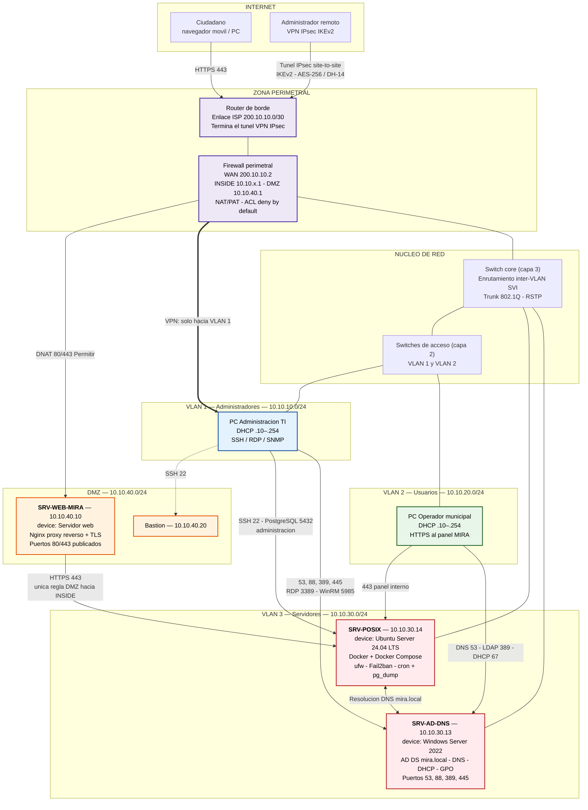
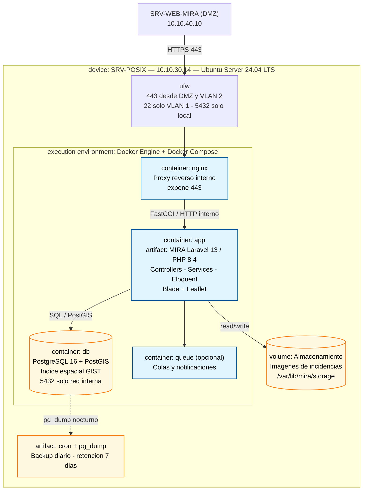
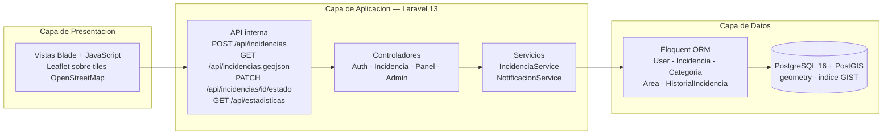
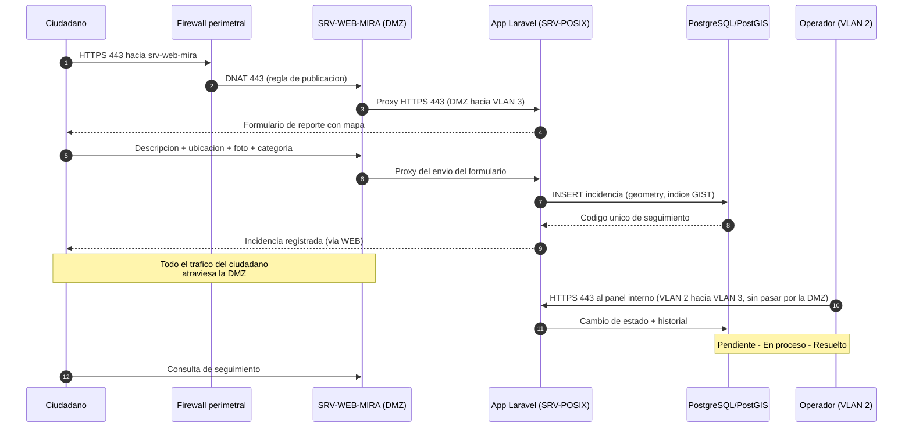
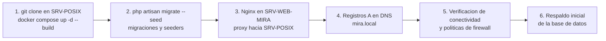

# MIRA — Diagrama de implementación (despliegue)

**Proyecto:** MIRA – Mapa de Incidencias, Reportes y Atención
**Equipo:** Bit Oriental — Grupo TC4
**Hito:** 1 — 18/09/2026
**Referencia:** secciones 4.14.4 (Arquitectura), 4.17 (POSIX), 4.18 (Redes Microsoft), 4.19 (Conectividad), 4.21 (Infraestructura y despliegue) y Anexo H (ESRE IEEE 830, interfaces de comunicación H.3.1.4)

---

## 1. Diagrama de implementación general (nodos y zonas de red)

> **Nota sobre las políticas del firewall:** el firewall perimetral aplica *deny by default*. Todo tráfico de Internet hacia las VLAN internas (1, 2 y 3) está denegado, así como el tráfico de la DMZ hacia INSIDE salvo la única regla `SRV-WEB-MIRA → SRV-POSIX 443` que muestra el diagrama. Las reglas denegadas no se dibujan como flechas porque representan tráfico que no existe (ver la tabla completa en 4.19.4).

---

## 2. Artefactos desplegados en SRV-POSIX (contenedores Docker)

---

## 3. Vista por capas de la aplicación

---

## 4. Flujo integral del sistema desplegado (escenario 4.22.2)

---

## 5. Tabla de nodos del diagrama

| Nodo | Equipo / SO | Zona | IP | Software desplegado | Puertos |
|---|---|---|---|---|---|
| SRV-WEB-MIRA | Servidor web | DMZ | 10.10.40.10 | Nginx (proxy reverso + TLS) | 80/443 externa |
| SRV-POSIX | Ubuntu Server 24.04 LTS | VLAN 3 | 10.10.30.14 | Docker: app Laravel 13, Nginx, PostgreSQL 16 + PostGIS | 443 interno · 5432 local |
| SRV-AD-DNS | Windows Server 2022 | VLAN 3 | 10.10.30.13 | AD DS (mira.local), DNS, DHCP, GPO | 53, 88, 389, 445 |
| Bastión | Host de salto | DMZ | 10.10.40.20 | Acceso administrado desde VLAN 1 | 22 |
| Router de borde | Router perimetral | Perimetral | Enlace ISP 200.10.10.0/30 | Enrutamiento WAN, terminación VPN IPsec | — |
| Firewall perimetral | Capa 3 con zonas de seguridad | Perimetral | 200.10.10.2 / 10.10.40.1 | ACL, NAT/PAT | — |
| Switch core | Switch multicapa (capa 3) | Núcleo | — | Inter-VLAN (SVI), trunk 802.1Q, RSTP | — |
| Switches de acceso | Switch de capa 2 | Acceso | — | Acceso VLAN 1 y 2 | — |
| PC Operador | Cliente | VLAN 2 | DHCP 10.10.20.10–254 | Navegador | 443 |
| PC Administración | Cliente TI | VLAN 1 | DHCP 10.10.10.10–254 | SSH, RDP, monitoreo SNMP | 22, 3389 |

---

## 6. Procedimiento de despliegue (4.21.3)

---

### Cómo visualizar y exportar

- **GitHub / GitLab:** renderizan Mermaid automáticamente al abrir el `.md`.
- **VS Code:** extensión *Markdown Preview Mermaid Support* (Ctrl+Shift+V).
- **Obsidian / Typora:** soporte nativo.
- **Exportar a imagen** para pegar en el documento integrador (que se entrega en Word/PDF): [mermaid.live](https://mermaid.live) → pegar el bloque → *Actions → PNG/SVG*.
